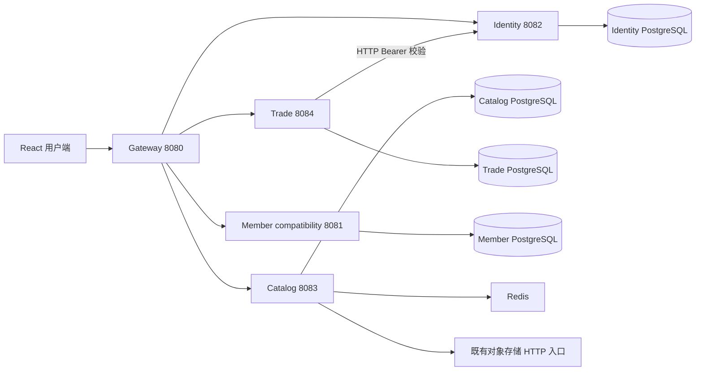

# 服务边界与路由

| 网关路径 | 归属 | 数据 |
| --- | --- | --- |
| `/api/health`、`/api/lectus-local/config` | gateway 本地接口 | 存活信息、前端扫码 origin |
| `/api/auth/**` | identity | accounts、auth_sessions |
| `/api/catalog/**` | catalog | catalog_*、来源图片/模型代理 |
| `/api/products`、`/api/products/**`、`/api/cart`、`/api/cart/**`、`/api/orders`、`/api/orders/**` | trade | products、product_skus、account_locks、cart_items、addresses、shop_orders、order_items |
| `/api/member/**`、`/api/lectus-demo/**`、`/api/addresses`、`/api/addresses/**` | member | 会员及原兼容表 v_*，演示表 |
| `/api/legacy/auth/**` | identity，去掉 legacy 段 | 旧版客户端兼容 |
| `/api/legacy/**` | trade，去掉 legacy 段 | 包含旧交易地址，避免与 Web 会员地址冲突 |
| `/api/member-platform/**` | member，去掉 member-platform 段 | 原会员项目其余接口的显式兼容入口 |

没有通用 API 转发兜底，未知路由返回 404。API 返回结构继续兼容两套客户端：核心交易为原 DTO，会员为 `{success,data,message}`。两套 Token 不通用；当前响应式 Web 使用 member 体系。生产 `/lectus/api/` 需由反向代理改写成网关 `/api/`，前端发布前缀保持 `/lectus/`。

身份与数据隔离是不同层次：当前已实现服务数据边界和用户资源访问检查，未实现商家/租户边界。不得将自行传入 X-Tenant-Id 或给商家展示独立页面当作租户隔离。

公共模块只共享 DTO、安全过滤器、错误格式和工具，不共享表实体或 Repository。当前保留 com.lectus.api 包名以降低迁移风险，每个可执行应用只装载自身服务类。会员模块使用独立 com.heng 包及框架版本，不依赖 common。

高可用、网关横向扩展与分布式限流尚待实现。旧认证端点的登录限流仍为进程内状态，多实例不能作为全局额度。生产环境下游应使用私有网络访问，并配置 HTTPS/反向代理、日志脱敏、指标访问控制、备份及恢复演练。
